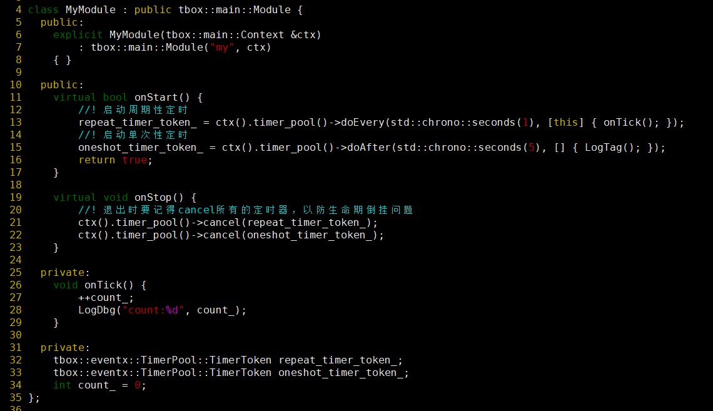
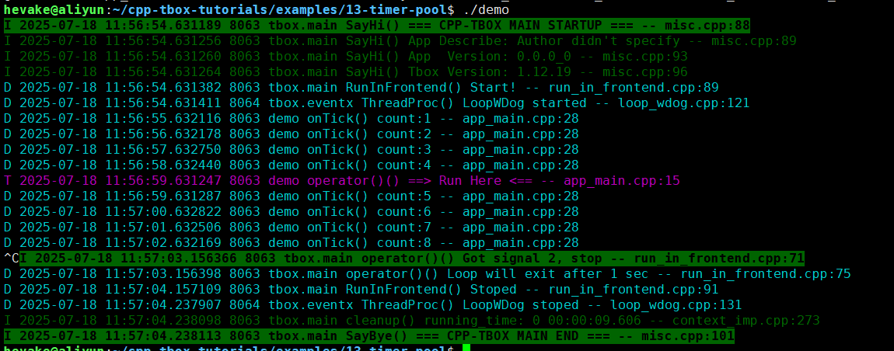

# 定时器池

在 [定时器](04-timer-event.md) 这一节中，我们学习了TimerEvent的实用，对定时器有了一定的了解。  

在实际的项目中，我们会发现`TimerEvent`使用起来不是很方便。为了使用它，我们需要调`ctx().loop()->newTimerEvent()`返回一个定时器对象的指针。为保证资源不泄漏，我们需要在当将Module的析构函数中进行销毁。有时我们只是临时需要一个单次定时器而已。这样的生命期操控不方便，很繁琐。  
为此，我们引入了`TimerPool`这个模块。  
TimerPool模块帮我们管理定时器的生命期。我们需要使用定时器的时候，调它的`doAfter()`或者`doEvent()`即可，非常方便。

在 tbox.main 框架中，直带定时器池。使用时只需要：`ctx().timer_pool()` 就可以得到`TimerPool`对象的指针。  
下面，我将使用一个示例程序进行展示：

  

(1) 在`onStart()` 中，分别启动了两个定时器。一个是用的`doEvery()`，另一个是`doAfter()`；  
(2) 在`onStop()` 中，取消了这两个定时器；

[示例工程目录](examples/13-timer-pool)  

编译后，执行效果：
  
可以看到周期性定时器有每秒触发。在第5秒时，单次定时器也触发了。

**注意**：  
虽然创建定时器方便了，但一定要注意生命期倒挂风险。  
所谓“生命期倒挂”具体表示为：所创建定时器时传入了一个生命期比较短的对象。在定时器触发时，这个对象的生命期已经提前结束了，进而导致不可预期的程序崩溃问题。  

-------
[[返回主页]](README.md)
