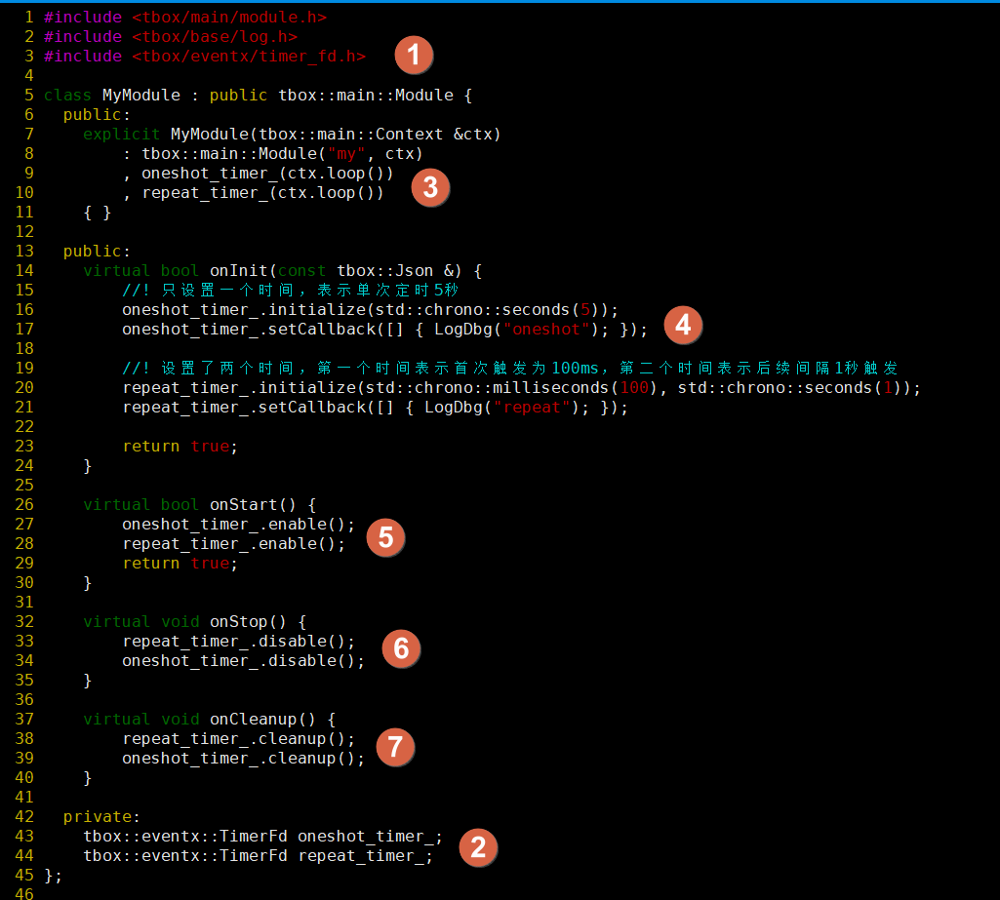
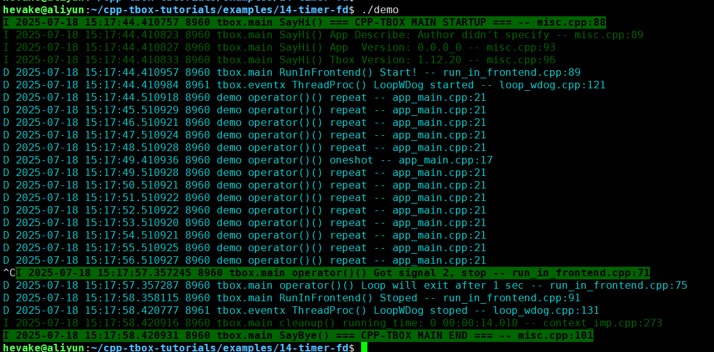

# TimerFd

在 [定时器](04-timer-event.md) 这一节中，我们提及到`TimerEvent`的实现。本质上，它是通过`epoll()`或`select()`中阻塞的超时参数来实现定时任务的。`TimerEvent`在实际运用中的会有约400us的误差。如果想要精度更好的定时器，则需要使用本节介绍的`TimerFd`。  
`TimerFd` 定义在 `eventx/timer_fd.h` 中，是基于Linux内核提供的`timer_fd`实现的。具体的原理可阅读相关文章《[Linux fd 系列 — 定时器 timerfd 是什么？](https://zhuanlan.zhihu.com/p/409434419)》

本节通过一个示例来引导大家掌握`TimerFd`的使用方法。

  

1) 与`TimerEvent`不同的是`TimerFd`不属于`Loop`的一部分，也没有被纳入到框架。要使用它，都需要`#include <tbox/eventx/timer_fd.h>`  
2) 在`MyModule`中分别实列化两个`TimerFd`对象：`oneshot_timer_`与`repeat_timer_`；  
3) 在`MyModule`的初始化列表中对`oneshot_timer_`与`repeat_timer_`进行构造。注意，它的初始化需要`ctx().loop()`获取的`Loop`对象指针；  
4) 在`onInit()`中对它们进行初始化，只传一个时间的表示单次触发；传两个时间的表示单次触发之后，还需要重复触发；
5) 在`onStart()`中使能它们。在工程中，不是一定要在`onStart()`中使能它们，根据业务需要我们也可以在需要的时间再使能它们；  
6) 在`onStop()`中关闭它们；  
7) 在`onCleanup()`中清理它们；  

[示例源码](examples/14-timer-fd/app_main.cpp)  
[示例工程目录](examples/14-timer-fd)  

编译后，执行效果：
  
我们注意到，它的定时精确误差在5us以内，非常可观。

思考：为什么使用`TimerFd`的精准度会比`TimerEvent`高这么多？  
猜想：由于`TimerFd`是基于Linux内核中的`timer_fd`实现的。在`timer_fd`触发超时时，内核立即让`timer_fd`的文件描述符变成可读，鉴于定时器的实时性要求，Linux内核会立即唤醒对应的线程并执行。而基于`epoll()`与`select()`超时参数的`TimerEvent`则得不到Linux内核的特殊照顾。当`epoll()`或`select()`等待超时后，Linux内核只将对应的线程设置为READY状态并排队等待CPU资源，以致于执行的时间点存在较大的误差。  

问题：`TimerEvent`,`TimerPool`,`TimerFd` 这三种实现方式如何抉择？  
回答：  
- 对于日常对精度要求不太高（如1ms精度可接受）的定时执行场景，可从`TimerEvent`与`TimerPool`中任选一种。如果是对精度要求高，要保证100us以内误差的，使用`TimerFd`；  
- 遇到首次触发与后续触发间隔不一致的，采用`TimerFd`。  

-------
[[返回主页]](README.md)
