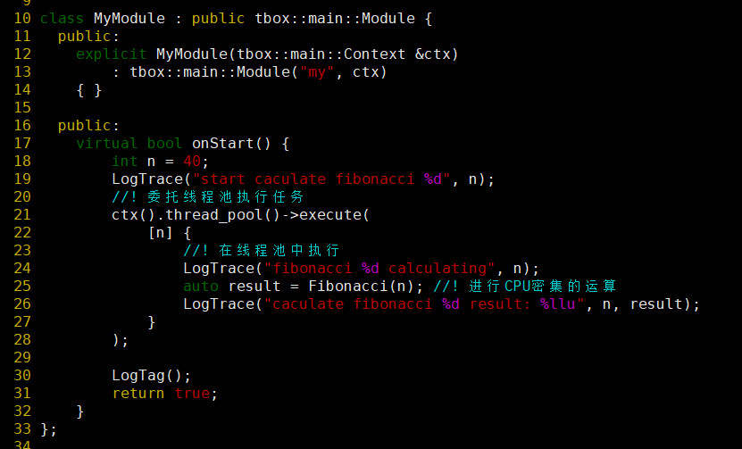
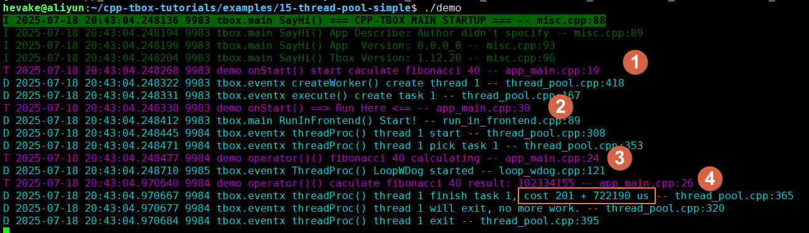
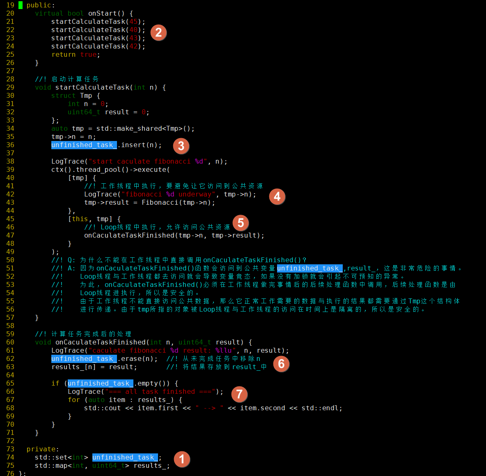
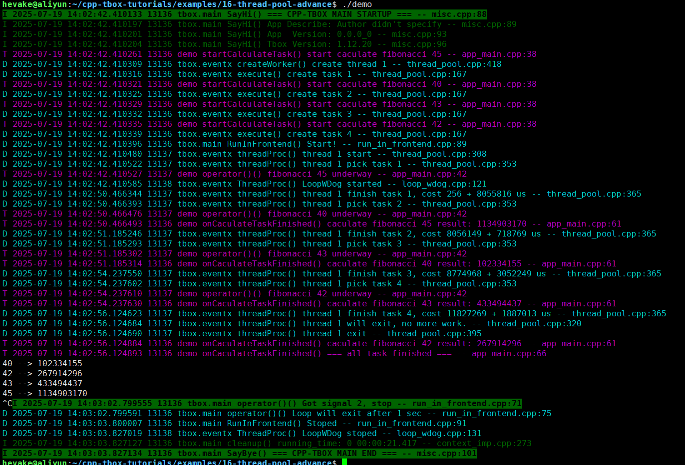
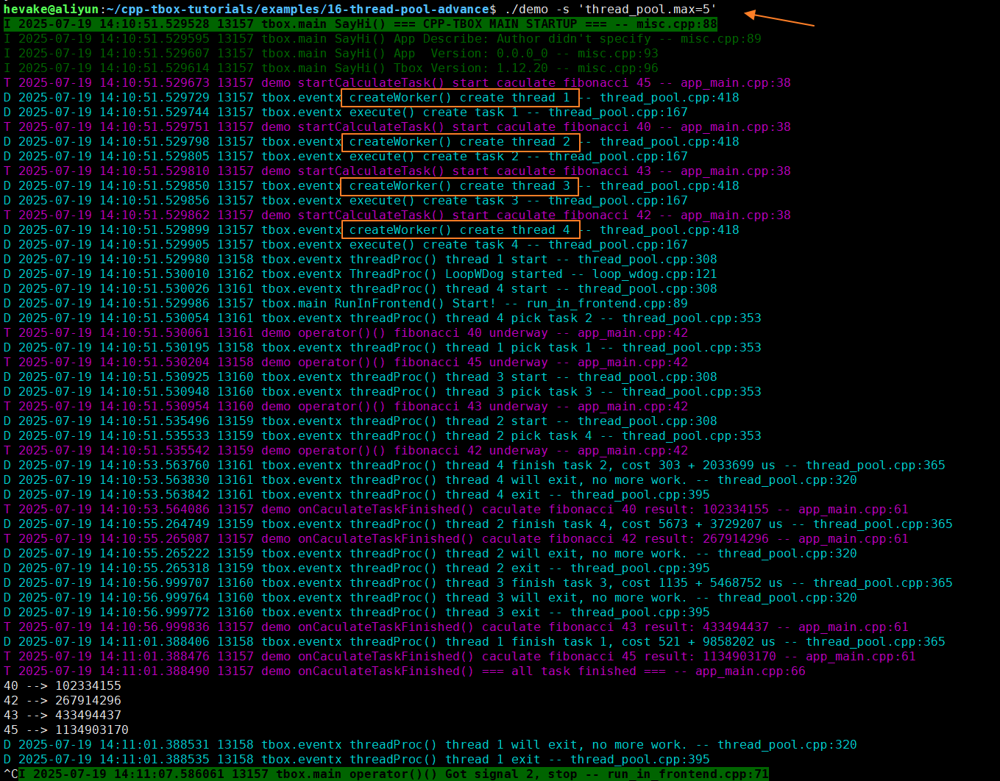
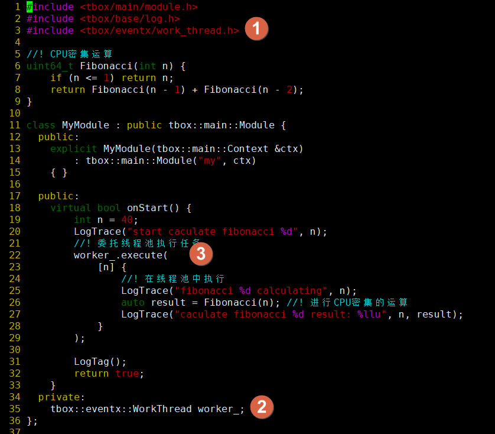
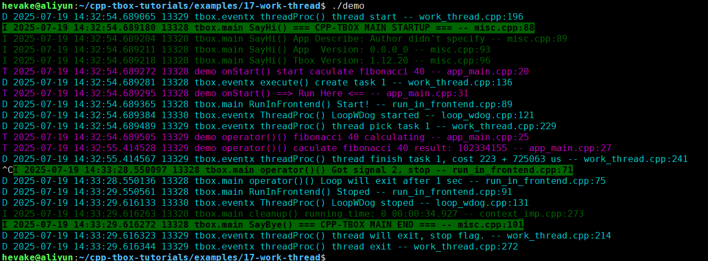

# 线程池与工作线程
由于cpp-tbox是基于事件驱动的编程模型，对于事件的处理要求不能阻塞。然而实际的工作中，多多少少会遇到一些需要阻塞的事务。比如说：大运算、调用第三方库的阻塞性接口等。  
这时，就得需要借助`ThreadPool`与`WorkThread`来解决问题。

## ThreadPool
所谓线程池，就是预先创建指定个数的线程，让他们等待队列传入的任务。当队列中有新的任务后，其中一个线程就能抢到任务，并开始执行。如果同时来多个任务，那么这些空闲的线程便从逐一从队列中领取任务。工作线程在执行完任务后，会继续检查任务队列中是否还有其它的任务。如果有，会继续领取任务并执行。否则，观察当前任务数是否大于预设个数，如果是则结束线程，不是则处理空闲等待状态。  
有了线程池，我们在开发中就不需要临时为阻塞性的函数调用创建线程，而是很方便地将这些阻塞性的函数调用委托给线程池，由线程池中的工作线程去执行。

### 基础用法
本节通过一个简单的示例来引导大家掌握`ThreadPool`的基础使用方法。



L21，在`onStart()`函数中直接使用`ctx().thread_pool()->execute(...)`委派任务给线程池执行。这是因为在tbox.main框架中，ctx 自带一个线程池对象。我们只需要通过`ctx().thread_pool()`即可获取并使用。  
L22~27，在工作线程中打印日志并执行`Fibonacci()`函数模拟CPU密集的运算。   

执行结果：  
  

注意观察上面日志中的线程ID，9983是Loop线程，9984是工作线程，9985是监控线程。  
(2)与(3)都是在工作线程中打印的。  
在最后黄框标记为线程池任务执行的耗时报告："cost 201 + 722190"，表示从任务派发到执行的等待时长为201us，而任务的执行花了722190us。  

[示例工程目录](examples/15-thread-pool-simple)  

### 进阶用法
上面对线程池的使用仅仅是让工作线程做了一件事情，不需要后续的处理。然而实际业务中往往不是这样的，比如：解析请求 --> 写数据库 --> 回复；其中"写数据库"这步操作是阻塞的。我们需要在让线程池写完数据后之后再在Loop线程中执行回复的动作。  
这就引入`execute()`的第二个参数：  
```
TaskToken execute(NonReturnFunc &&backend_task, NonReturnFunc &&main_cb, int prio);
```
这个参数传入的是一个函数对象，即工作线程执行完后，由Loop线程执行的后续处理。

接下来，我用另一个较为复杂一点的示例向大家展示它的使用场景：


这个示例也是让程序计算`Fibonacci()`。不同的是，让它一次性计算多个数值，而且Loop线程要在所有的计算都完成之后打印计算结果。  
实现的方式大致为：Loop线程向线程池委派计算任务，在每一个工作线程完成了任务之后，让Loop线程记录计算结果，检查是否所有的计算都已完成。如果已完成，Loop线程打印所有的结果。  

具体的实现：  
(1) 定义两个成员变量`unfinished_task_`，用于记录还有哪些任务没有完成；再定义`results_`记录不同数值计算所得的结果；  
(2) 在`onStart()`中调4次`startCalculateTask()`，启4个计算任务；  
(3) 在`startCalculateTask()`中，将需要计算的数值写入到`unfinished_task_`集合中。还需要定义`Tmp`结构体用于传递数据。注意，这里是Loop线程在执行，操作成员变量是安全的；并创建了`Tmp`结构体作为与子线程进行数据交换的媒介；  
(4) 这里由工作线程在进行计算。在这里，是从`tmp->n`中取值进行操作，完成之后也是将结果记录到`tmp->result`中。整个过程没有操作成员变量，不需要加锁；  
(5) 这里是由Loop线程执行的匿名函数，它会在工作线程执行完成之后被Loop线程调用。它的职责是处理`tmp`中的结果。  
(6)(7) 这是在做计算结果的处理。它有被Loop线程调用的，直接访问成员变量是安全的，无需加锁。  


编译执行的效果：  
  
注意观察可见：  
1. 确实是子线程在进行计算；  
2. 最后的结果打印是主线程；  
3. 所有的任务都只被一个工作线程执行； 

Q: 为什么只有一个工作线程呢？  
A: 因为在tbox.main的框架配置中，线程池的默认配置为：最小0个，最大1个线程；

如果想看到并行运算的效果，那要将最大线程数调大一点。在运行时指定`thread_pool.max`参数的值即可：  
```
./demo -s 'thread_pool.max=5'
```  
运行效果：  
  
从上可以看到，程序在启动时就为每一个任务创建了一个工作线程。  

[示例工程目录](examples/16-thread-pool-advance)  

## WorkThread
工作线程与线程池的接口很像，区别在于`WorkThread`内部只有一个工作线程，相当于简化版本的`ThreadPool`。由于`WorkThread`只有一个工作线程，提交给它的任务是按顺执行的。为此，我们会使用它来实现对执行顺序有要求的场景。

本节将用示例展示`WorkThread`的使用方法。如下图所示：
  
(1) 首先，需要`#include <tbox/eventx/work_thread.h>`；  
(2) 要在定义成员变量`worker_`；  
(3) 将上一节课中的`ctx().thread_pool()->`替代为`worker_.`即可；  

运行效果：  
  
可以看到，与线程池很相像；  

[示例工程目录](examples/17-work-thread)  

-------
[[返回主页]](README.md)

