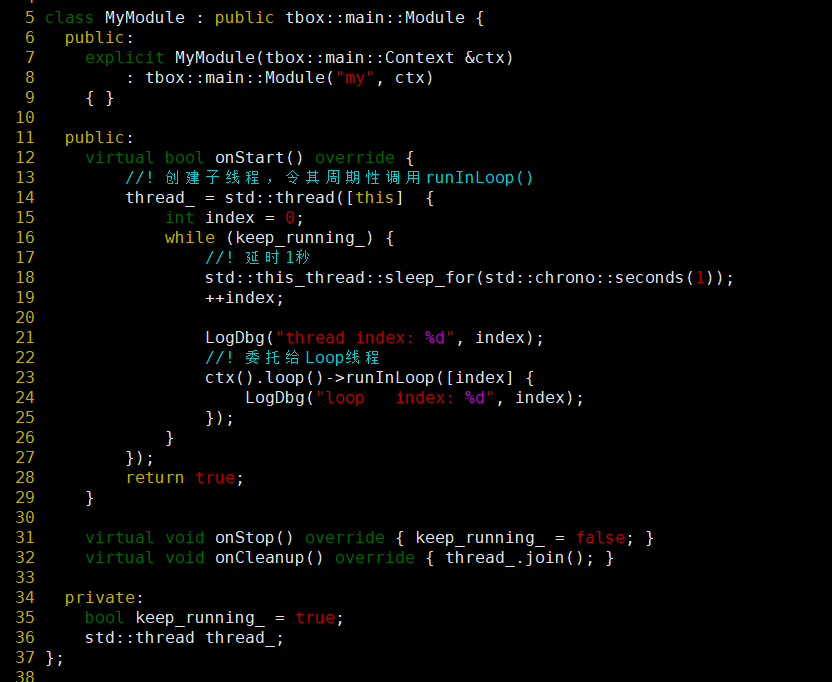
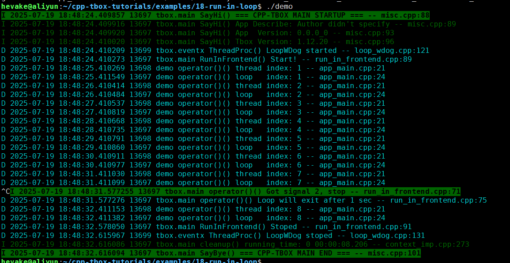

# runInLoop

前面学会了使用线程池与工作线程，在Loop线程中向子线程委派任务。反过来，子线程也应该可以向Loop线程委派任务。  

这种场景非常多。比如：我们使用一个第三方的通信库，这个库内部有自己的子线程，在特定的情况下会回调我们预先设置的回调函数。  
以ROS为例，它自己内部会为Topic创建多个消息接收线程。在收到消息的时候，其中的子线程会调用我们注册的回调函数，让我们处理消息。由于这是ROS内部的子线程调用的，我们不能直接让它在不加锁的情况下访问公共的数据，否则会导致多线程访问共同资源竞态，引起不可预知的后果。为了在无锁的情况下进行数据，我们常规的做法是委派给Loop线程来执行后面的操作。  

本节通过一个简单的示例来引导大家掌握`runInLoop()`的使用方法。

  
本示例很简单：  
- 在`onStart()`中，启动了一个子线程。这个子线程循环调用`ctx().loop()->runInLoop(...)`；
- 分析在L21与L24打印日志。

[示例源码](examples/18-run-in-loop/app_main.cpp)  
[示例工程目录](examples/18-run-in-loop)  

编译后，执行效果：
  
注意观察日志的打印中的线程号，可以看到"thread index" 是由子线程执行的，而"loop thread"则是由Loop线程的。  
这说明达到我们期望的效果。

-------
[[返回主页]](README.md)
