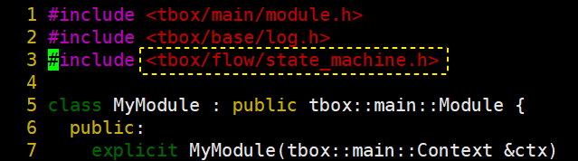
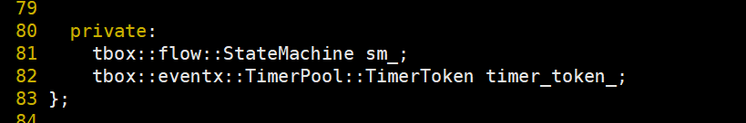
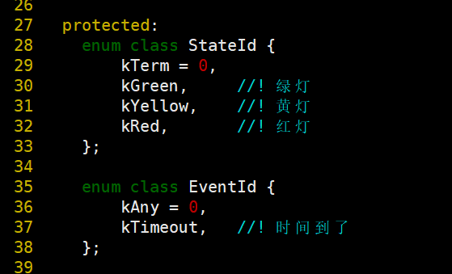
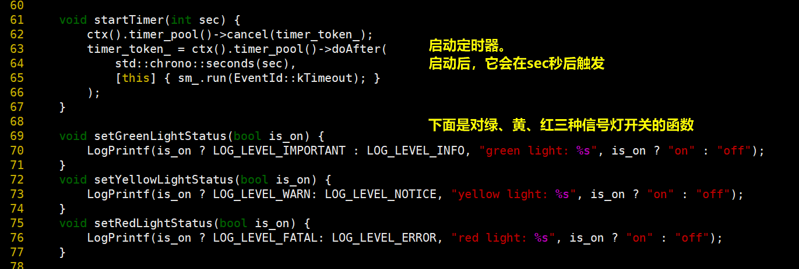
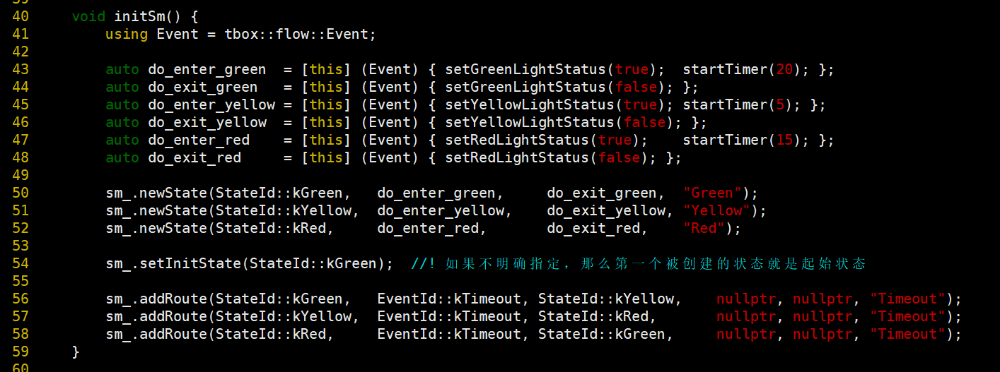
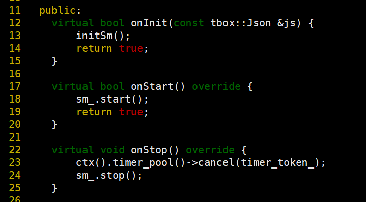
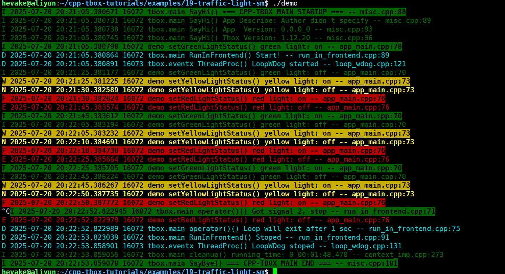

# 状态机

## 什么是状态机
状态机（State Machine）是一种行为设计模式，它允许对象在其内部状态发生变化时改变其行为。这种模式将状态封装成独立的类，并将动作委托给当前状态对象。  
状态机在处理复杂的条件逻辑时特别有用，例如游戏开发、工作流引擎、编译器设计、网络协议实现等场景。  

状态机的核心概念：  
- 状态（State）：对象在其生命周期中可能处于的特定条件或模式。每个状态定义了对象在该状态下的行为。
- 事件（Event）：触发状态变化的外部或内部事件。
- 跳转（Route）：当特定事件发生时，状态机从一个状态转换到另一个状态的过程。
- 动作（Action）：状态转换过程中执行的操作，可以在进入状态、退出状态或转换期间执行。

参考资料：
- [什么是状态机？](https://zhuanlan.zhihu.com/p/47434856)

在设计模式中有“状态机模式”，见网上的文章：《[状态机模式](https://mycroftcooper.github.io/2021/09/01/%E8%AE%BE%E8%AE%A1%E6%A8%A1%E5%BC%8F-%E7%8A%B6%E6%80%81%E6%A8%A1%E5%BC%8F/)》。  
由于cpp-tbox不是这么实现的，所以不再赘述。有兴趣的朋友可以自行查资料。  

为什么作者本人不采用这种方式呢？因为本人觉得这种实现比较繁琐与拖沓。在实际的工程实际中，用这种方式实现状态机会让我们反反复复通过继承的方式定义很多状态类，不方便维护。在cpp-tbox里采用的是状态表的实现方式。

状态机的本质，就是先创建几个状态（State），再为这些状态添加遇到不同事件（Event）的跳转（Route）。当然，这些跳转并不同一发生事件就跳转的，有些也需要满足一定的条件。这可以用一张状态表进行描述，也是我们实现状态机的思想。  

具体的代码实现见源码：[state\_machine.h](https://gitee.com/cpp-master/cpp-tbox/blob/master/modules/flow/state_machine.h) 与 [state\_machine.cpp](https://gitee.com/cpp-master/cpp-tbox/blob/master/modules/flow/state_machine.cpp)

## 实现个交通信号灯
接下来我们通过模拟红绿灯的状态，来向大家展示cpp-tbox中状态机的使用；  

### 方案设计
为方便学习，我们抛开细节，简化一下红绿灯的功能：  
- 最开始是绿灯；
- 绿灯亮20秒，转黄灯；
- 黄灯亮5秒，转红灯；
- 红灯亮15秒，转绿灯；

首先，我们一起罗列一下有哪些状态，以及进入与退出该状态的动作：  
| 状态 | 进入动作 | 退出动作 |
|:----:|:----:|:----:|
| 绿灯 | 开始计时20秒，亮绿灯 | 灭绿灯 |
| 黄灯 | 开始计时5秒，亮黄灯 | 灭黄灯 |
| 红灯 | 开始计时15秒，亮红灯 | 灭红灯 |

初始状态：绿灯  
终止状态：无

接下来，我们罗列各个状态之间的跳转
| 源状态 | 事件 | 目标状态 | 跳转条件 | 执行动作 |
|:----:|:----:|:----:|:----:|:----:|
| 绿灯 | 时间到 | 黄灯 | 无 | 无 |
| 黄灯 | 时间到 | 红灯 | 无 | 无 |
| 红灯 | 时间到 | 绿灯 | 无 | 无 |

至于计时，我们采用之前在《[定时器池](12-timer-pool.md)》中学到的`ctx().timer_pool()->doAfter(...)`；

### 代码实现
首先，我们需要包含状态机的头文件：`tbox/flow/state_machine.h`，如下：  
  

然后，在类中定义状态机对象`sm_`与后面定时要用到的`timer_token_`：  

定义状态枚举类型与事件枚举类型：  
  
如上，我定义了三种状态：绿灯、黄灯、红灯。一定要注意：**状态枚举中的0是保留的，表示终止状态**。所以上面的代码中定义了`kTerm = 0`，预留了0值。这点大家一定要记住！  
我们还定义了事件。目前只有一种事件，就是超时。一定要注意：**事件中的0也是保留的，表示任何事件**。正常我们定义的事件不能使用0。为此，我们定义了`kAny = 0`预留了它。  

接下来，实现打开定时器与开关信号灯的函数：  
  
我们先看`startTimer()`的实现：  
L62，为防止重复开定时器，在开定时器之前先取消之前创建的定时器。如果`timer_token_`为空，或者定时器不存在，也不会有什么操作； 
L63~66，这里使用定时器池创建了一个新的定时器，它将在`sec`秒后触发。执行的内容便是往状态机`sm_`中投喂`kTimerout`事件。  

L69~77，定义了`setXXXXLightStatus()`三个函数是分别操作绿、黄、红三种信号灯开关。这里为了演示效果，就直接令其打印日志即可。  

重点了来了。接下来，我们要实现`initSm()`函数。它负责对状态机的初始化：  
  
L41，为了方便，将 `tbox::flow::Event` 重命名为 `Event`，将在L43~48中使用；  
L43~48，定义每种状态进入与退出时的动作。以绿灯状态为例，进入时要将绿灯打开，并启动20秒的定时器；退出则要关闭绿灯。黄灯、红灯一样的操作。  
L50~52，分别创建三种状态，并为每个状态指定进入与退出时的动作；  
L54，指定起始状态。这步不是必须的，如果不明确指定则创建的第一个状态就是起始状态；  
L56~58，添加状态之间的跳转。目前业务比较简单，每种状态都只在遇到`kTimeout`事件时跳转到下一个状态。  

最后，在`onInit()`中调`initSm()`初始化状态机；在`onStart()`中调`sm_.start()`启动状态机；在`onStop()`中调`sm_.stop()`停止状态机：  

完成！  

[示例源码](examples/19-traffic-light-sm/app_main.cpp)  
[示例工程目录](examples/19-traffic-light-sm)  

### 执行效果

编译后，执行效果：
  
可以看到：  
- 它是按绿、黄、红循环亮灯的；  
- 在最后程序退出的时候，正在亮着的红灯是会被关闭的；  

达到预期效果！

## 总结

首先，要梳理状态机的需求。明确有哪些状态，哪些事件，状态之间的跳转。  
然后，将需求翻译成代码，通过`newState()`创建状态，通过`addRoute()`添加状态之间的跳转；  
最后，将事件通过`run(...)`喂给状态机；

注意点：  
- 0状态保留为终止状态，不要使用；
- 1事件保留为任务事件，不要使用；
- 不要在状态动作函数中再调`run(...)`函数，会失败。  
用`ctx().loop().runInLoop([this] { sm_.run(XXXX); });` 包起来；  

-------
[[返回主页]](README.md)
